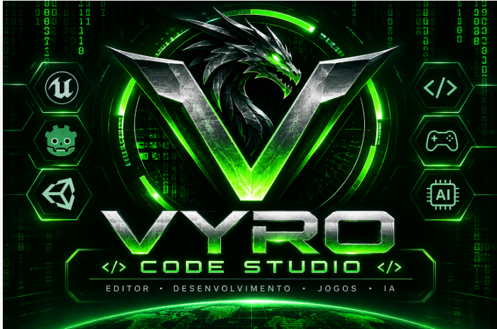

<div align="center">



# VYRO CODE STUDIO

**CODIFIQUE. CRIE. EVOLUA.**

</div>

# VYRO Code Studio

**Editor de código em desenvolvimento, derivado do Notepad++.** Interface e documentação em português brasileiro.

> **Estado: experimental.** A base C++ foi compilada com sucesso, mas o executável rebatizado e o pacote completo ainda precisam de testes. Os laboratórios HTML e módulos Node.js são independentes e não estão integrados ao editor C++.

**Desenvolvimento:** Walney Moreira Klein — walneyk@hotmail.com  
**Base original:** [Notepad++](https://github.com/notepad-plus-plus/notepad-plus-plus) — Don Ho e colaboradores.  
**Fork:** https://github.com/WalneyNF/VYRO-Code-Studio  
**Branch com novidades VYRO:** `feature/vyro-code-studio`.

## Objetivo

Construir um editor leve e extensível com IA para auxiliar diretamente no código, divisão de painéis (split editor), extensões, integração com Godot, Lua, Roblox Studio/Luau, Unity e Unreal Engine. **Esses são objetivos; nem todos estão implementados.**

## Como baixar para testar agora

**Pré-requisitos:** Windows e navegador moderno. Para executar os testes Node e usar os adaptadores de IA, instale Node.js. Para conversar com modelos locais, instale Ollama e baixe um modelo.

### Opção A — Baixar ZIP sem Git

1. Acesse [a branch VYRO no GitHub](https://github.com/WalneyNF/VYRO-Code-Studio/tree/feature/vyro-code-studio).
2. Clique em **Code → Download ZIP**.
3. Extraia o ZIP para uma pasta de sua escolha.
4. Abra `vyro-ai-center.html` no navegador para experimentar o cadastro de provedores, Skills e MCP.
5. Abra `vyro-split-ai-lab.html` para testar a divisão de painéis, edição, segundo arquivo, consulta ao Ollama e propostas de alterações.

**Importante:** abrir os HTMLs não instala o editor nativo. A comunicação direta do navegador com o Ollama pode falhar por restrições de CORS.

### Opção B — Clonar com Git

```powershell
git clone --branch feature/vyro-code-studio https://github.com/WalneyNF/VYRO-Code-Studio.git
cd VYRO-Code-Studio
```

O comando baixa a branch com os protótipos e manuais. Para atualizar posteriormente: `git pull`.

## Configurar IA local com Ollama

1. Instale e inicie o Ollama: https://ollama.com/
2. No terminal, execute `ollama list` para ver os modelos instalados.
3. Se necessário, baixe um modelo com `ollama pull qwen2.5-coder:3b` (nome de exemplo; confirme disponibilidade).
4. Teste a API no PowerShell: `Invoke-RestMethod http://127.0.0.1:11434/api/tags`.
5. Abra `vyro-split-ai-lab.html`, escolha um modelo instalado, escreva uma pergunta e clique em **Perguntar**.
6. Se aparecer erro de CORS, não desative a segurança do navegador globalmente. A ponte local autenticada ainda precisa ser implementada.

O laboratório permite **abrir arquivo**, **salvar por download**, **dividir a tela**, **consultar a IA**, **rejeitar proposta** e **aplicar proposta mediante confirmação**. **A proposta ainda é texto bruto e substitui todo o conteúdo do editor, não é um diff por trecho.** Faça cópia do arquivo antes de testar.

## Recursos disponíveis e limitações

| Componente | Estado |
|---|---|
| `vyro-ai-center.html` | Cadastro experimental de IA, Skills e MCP; chat Ollama sujeito a CORS |
| `vyro-split-ai-lab.html` | Split editor web, segundo arquivo e consulta experimental ao Ollama |
| `vyro-platform/src/ai-providers.cjs` | Adaptadores de chat sem streaming para Ollama, Gemini e APIs compatíveis com OpenAI; testes simulados |
| `vyro-platform/src/language-engine.cjs` | Detecção e autocomplete heurístico, sem LSP |
| `vyro-platform/src/extension-host.cjs` | Host experimental Node; **não é sandbox** |
| `vyro-platform/src/engine-bridges.cjs` | Detecção básica de projetos Godot, Unity e Unreal |
| Roblox Studio/Luau e Lua | Compatibilidade completa ainda pendente |
| MCP e Skills | Cadastro demonstrativo; sem execução integrada |
| Editor C++ VYRO e instalador | Base C++ compilada; identidade VYRO em implementação; instalador pendente |

**Segurança:** não coloque chaves de API em JSON público, Git, HTML ou localStorage. Não execute extensões Node desconhecidas. Confirme toda alteração sugerida por IA.

## Executar os testes automatizados

Na raiz do repositório, com Node.js instalado:

```powershell
node vyro-platform/tests/ai-providers.test.cjs
node vyro-platform/tests/language-engine.test.cjs
node vyro-platform/tests/extension-host.test.cjs
node vyro-platform/tests/engine-bridges.test.cjs
```

Esses testes validam módulos experimentais, **não** uma instalação nativa completa nem conectividade real com todos os provedores.

## Compilar o editor C++ original

A base inclui solução Visual Studio em `PowerEditor/visual.net/notepadPlus.sln`. É necessário configurar a toolchain C++ e as dependências conforme [BUILD.md](BUILD.md) e o [manual de instalação e compilação](manuais/INSTALACAO-E-COMPILACAO.md). A compilação do VYRO ainda não foi validada; não considere o resultado um instalador VYRO pronto.

## Manuais e pesquisa

- [Índice dos manuais](manuais/README.md)
- [Instalação e compilação](manuais/INSTALACAO-E-COMPILACAO.md)
- [Adaptadores de IA](manuais/ADAPTADORES-IA.md)
- [IA, Skills e MCP](manuais/IA-SKILLS-MCP.md)
- [Extensões](manuais/EXTENSOES.md)
- [Godot, Lua, Roblox, Unity e Unreal](manuais/ENGINES.md)
- [Matriz de compatibilidade prioritária](manuais/PRIORIDADE-COMPATIBILIDADE.md)
- [Pesquisa VS Code e melhorias VYRO (HTML)](manuais/PESQUISA-VSCODE-MELHORIAS-VYRO.html)
- [Roadmap](VYRO-ROADMAP.md)

## Licença e créditos

Este projeto é derivado do Notepad++ e preserva a licença principal **GNU GPL versão 3**, com esclarecimentos e exceções do arquivo [LICENSE](LICENSE). Dependências podem possuir licenças adicionais. Consulte [Licença e créditos](manuais/LICENCA-E-CREDITOS.md).

**VYRO Code Studio — Walney Moreira Klein — walneyk@hotmail.com.**  
**Notepad++ — Don Ho e colaboradores.**

O VYRO não é uma versão oficial do Notepad++.


## Identidade visual e divulgação — VYRO Code Studio

**Slogan:** CODIFIQUE. CRIE. EVOLUA. 🐉

A identidade visual aprovada combina o símbolo V com dragão metálico, fundo preto e verde-neon, para expressar programação, desenvolvimento de jogos e inteligência artificial. A marca do fork é **VYRO Code Studio**, com créditos a **Walney Moreira Klein — walneyk@hotmail.com**.

**Materiais de divulgação:** landing page HTML responsiva, logo PNG, ícone Windows ICO, ícones PNG em múltiplas resoluções, wallpaper, manual de marca, press kit e campanha de lançamento. O kit foi preparado como artefato separado para ser copiado para o repositório; sua presença nesta branch ainda precisa ser confirmada antes da publicação.

**Estado do editor em 05/11/2026:** a solução nativa C++ foi compilada com sucesso pela primeira vez (MSBuild, saída 0). Uma segunda compilação foi iniciada após alterar o nome do projeto, o nome de saída previsto para `VYRO-Code-Studio.exe` e metadados de produto. A abertura do executável rebatizado, a aplicação do novo ícone, o idioma pt-BR padrão e a integração nativa do Unreal Dev Kit **ainda precisam de validação**. Os laboratórios HTML/Node continuam separados.

**Marca e licenças:** o VYRO é um fork independente do Notepad++. Manter os créditos, avisos de copyright e obrigações GPL da base e bibliotecas. Referências a Unreal, Godot e Unity não implicam parceria ou endosso oficial.

**Mensagem pública:** editor experimental em desenvolvimento, com base C++ compilada e objetivos de evolução para jogos e IA. Não anunciar integração completa antes de testes funcionais.
